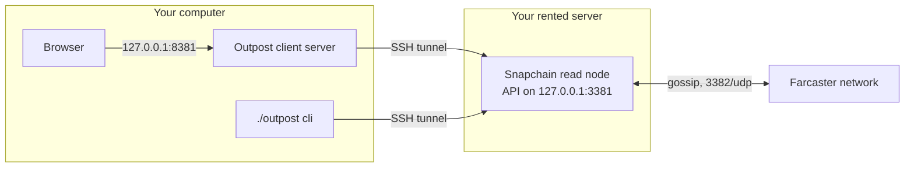

# Outpost

[](https://github.com/Spider333/outpost/actions/workflows/test.yml)

Outpost gives you your own way into Farcaster: a server running a Snapchain read node, and a
client on your computer that reads from that node and posts through it. Three commands, no API
keys from anyone.

It is for people who want to read and post on Farcaster from infrastructure they control, and
for developers who want a tested example of reading straight from Snapchain and adding a gasless
app key.

- **What you get**: a Snapchain read node on a server you rent, a web client at
  http://127.0.0.1:8381, and a command-line client with the same features.
- **What it costs**: the server, billed by the hour while it exists. On DigitalOcean (October
  2026 list prices) the 1.2 TB volume is about $0.16/h. The droplet is 8 vCPU / 32 GB at $0.25/h
  for the first sync, and 2 vCPU / 8 GB at $0.06/h after `./outpost shrink`: about $0.41/h in
  all while it syncs, then about $0.23/h ($5.50 a day). `./outpost destroy` deletes the server,
  volume and firewall and stops the bill.
- **How long it takes**: the first sync takes 6 to 8 hours. On our test server (DigitalOcean,
  8 vCPU, 32 GB RAM, 1.2 TB volume, 18 to 19 October 2026) it was 1 h 43 min to load the snapshot
  and 4 h 11 min to catch up; our first outside tester's run on 22 October 2026 took 7 h 33 min.
  The client works once loading is done.

Tutorial, with the output of every step from a real run: https://spider333.github.io/outpost/
(source: [site/index.html](site/index.html)).

## Quickstart

You need:

- A DigitalOcean (`doctl`) or Hetzner (`hcloud`) account, logged in. Or any Ubuntu 24.04
  server with root SSH and at least 1 TB of disk: `OUTPOST_HOST=<ip> ./outpost node`.
  New DigitalOcean accounts may be refused the 1.2 TB volume ("invalid size specified"); then
  ask their support to raise the volume limit, or use Hetzner or a server you already have.
- Node.js 20 or newer, for the client.
- A test account for Farcaster that already has storage.

```
./outpost provision   # rent a server with a 1.2 TB disk (DigitalOcean; 1 TB on Hetzner), billed by the hour
./outpost node        # start a Snapchain read node on it; the first sync takes 6 to 8 hours
./outpost client      # open http://127.0.0.1:8381
```

Once `./outpost status` says synced, `./outpost shrink` moves the server to 8 GB of RAM (a
synced node used about 3 GB on our server), and the bill drops from about $0.41/h to $0.23/h on
DigitalOcean.

When you are done:

```
./outpost uninstall   # revoke the CLI's app key; a key added in the web client: "Revoke this key" there
./outpost destroy     # delete the server and stop paying
```

Every command is safe to run twice. `--dry-run` on `provision`, `shrink` and `destroy` prints
the exact provider commands without running them. `./outpost status` shows the server and how
far the node has synced.

Just trying it? `./outpost provision --watchdog 24` deletes the server for you after 24 hours,
or after 2 hours with no progress. Ran it? [VOUCHER.md](VOUCHER.md) has a checklist and a
draft cast.

With an AI coding assistant that can run commands (Claude Code, Codex, Cursor), paste:

```
Help me run Outpost (https://github.com/Spider333/outpost). Read its README and AGENTS.md first. Then take me through provision, node and client one step at a time: before each command, say what it does and what it costs, and wait for my OK. I will type any cloud token or recovery phrase myself in my own terminal, never in this chat.
```

## Before you paste a recovery phrase

A recovery phrase is the custody key of an account. Whoever has it can transfer the account,
add or remove every app key and change the username. Treat pasting it like running
`rm -rf /` as root. Use a test account only, prefer the wallet path, and revoke the key when
you are done. Outpost uses the phrase in memory to sign one authorization for a scoped,
expiring app key and keeps no copy.

## How it works



- **provision** creates a small server (2 vCPU / 8 GB on DigitalOcean, `ccx13` on Hetzner;
  `--small-size` to change), a 1.2 TB volume (`--disk` to change) and a firewall that opens
  only SSH (22/tcp) and gossip (3382/udp). On Hetzner the volume is 1 TB, because new Hetzner
  accounts can hold at most 1024 GB of volumes; the data fits, since Outpost never keeps the
  snapshot and the database on the volume at once.
- **watchdog**: `provision --watchdog <hours>`, or `./outpost watchdog start --hours <n>` later,
  deletes the server, volume and firewall when the time is up, or when the node shows the same
  progress for 2 hours (`--stall-hours`) once it has started. It runs on your computer, because
  deleting needs your provider login, which never goes to the server. If the computer sleeps,
  it acts when it wakes. `./outpost watchdog stop` keeps the server; `./outpost status` shows it.
- **node** runs the official `farcasterxyz/snapchain` image, pinned to 0.14.3, as a read node.
  The HTTP and gRPC ports are bound to 127.0.0.1, because an open node lets anyone submit
  messages through it. It does not use the official installer, which needs a terminal and can
  stop before starting the node (snapchain issue #1030).
  On a server that `provision` made, it first sizes the server up to 8 vCPU / 32 GB (`ccx33` on
  Hetzner; `provision --size` to change) for loading the snapshot, which needs the memory: the
  server restarts once, about a minute offline.
  On a new server it loads the network snapshot itself, 8 chunks at a time, streamed straight
  into the database: about 4 times faster than Snapchain's own loader, which goes one chunk at a
  time, and it never needs room for the snapshot and the database at once. Each shard goes into
  the database only when it is complete, and `./outpost node` resumes an interrupted load.
  `OUTPOST_FAST_RESTORE=0` uses Snapchain's loader instead. The node's log is capped at
  3 x 50 MB, so it cannot fill the server's disk.
- **shrink** moves the server back to its small size once the node is synced: a synced node
  used about 3 GB of RAM on our server. Only CPU and RAM change. The disk stays the small
  size's, which is what lets the server go back down, since no provider shrinks a disk. The
  chain data is on the volume, and the address, firewall and society members stay. It refuses
  before the node is synced, and on a server it did not make small.
- **client** opens an SSH tunnel to the node and serves the web client on 127.0.0.1:8381. Reads
  and writes both go through your node: the feed is built from its data, and each message you
  sign is submitted to it and relayed from there to the network.

## How it differs from a typical Farcaster app

- **Your own read node.** The client reads from a node you run. A typical app reads through its
  company's servers or a hosted API.
- **A narrow app key.** Logging in adds a gasless app key (`KEY_ADD`) that can only cast, react
  and follow, and undo those. It expires 30 days after last use (`--ttl-days`, 1 to 90, in the
  command-line client).
- **Revoke without the phrase.** The key revokes itself: `./outpost uninstall`, or the
  "Your app key" panel in the web client.
- **A labelled, chronological feed.** The following feed is in time order, and each cast is
  labelled with the app that posted it. You can show only, or hide, any app.
- **Societies (Charter).** A society is a signed `charter.json`: members, moderators, which apps
  to include or exclude, feed rules and a code of conduct link. Loading one applies its lens;
  Join follows its members; Leave drops the lens and keeps your keys, follows and posts. A census
  panel shows members, active members, casts per day and the apps members post from, all
  computed from your node. Examples are in [examples/](examples/).
- **Society votes.** Members change their charter by liking a proposal, in any Farcaster app.
  It passes when more than half of the members have liked it, and anyone can recount it from
  their own node. See [Society votes](#society-votes).

- **Every message checked.** The client checks the hash and signature of every message it reads,
  and that the signing key belongs to the author, before showing it. A node that alters or makes
  up messages gets caught; [TRUST.md](TRUST.md) says how far that goes.

The client connects an account with a wallet signature or a test account's recovery phrase, and
casts, replies, likes, recasts and follows. On a society node with a sponsor, someone without an
account can create one in the client (see below). The command-line client has the same features:
`./outpost cli --help`.

Which accounts can post from Outpost:

| You have | Then |
|---|---|
| No Farcaster account | On a society node with a sponsor: "I have no Farcaster account" makes one in a minute. The society pays the $0.20 fee; you need no ETH, invite code or X account. |
| An account made in the Farcaster app | Read here, post in the app for now (see Limits). |
| An account whose owner key is in a browser wallet | "My account's owner key is in a browser wallet". |
| A test account's recovery phrase | "I have a test account's recovery phrase". |

## Society votes

Members add or remove members and moderators by vote. Four rules (`src/core/votes.ts`):

1. A proposal is a member's cast that names the charter's current version and lists the changes,
   each account as a mention.
2. An approval is a member's like on it, from any app. Once a client has seen it, it counts for
   good.
3. It passes when more than half of the members of that version approve. Leaving needs only your
   own approval.
4. The charter becomes a log: the founder's signed charter, then each passed proposal with the
   signed likes that passed it. A log that branches is shown, never merged.

There are no deadlines: Farcaster timestamps are set by the author and can be backdated, so a
"closes on Friday" rule could not be checked afterwards. A proposal stops counting once another
passes, because it names an older version.

```
./outpost cli charter propose society.log.json --add dwr --remove 1234   # posts and approves it
./outpost cli charter proposals society.log.json   # adds what passed to the file, lists the rest
./outpost cli charter verify society.log.json      # recount every amendment from your node
./outpost cli charter announce society.log.json    # reply under the proposal with the result
./outpost cli charter import theirs.json society.log.json   # take a newer log from a member
```

A plain founder-signed `charter.json` is a log with no amendments yet. The web client does the
same in the Society card: open proposals with their approvals, Approve, Propose a change,
Recount, and Download log.

To try it without mainnet accounts, `npm run build && node --import tsx test/votes-demo.ts` runs
a fake node with a 5-member society and an open proposal, and prints the steps.

Limits: votes are public; members who stay silent count as "no", so a society freezes if half
of its members go quiet (they can leave, or the founder can start a new charter); a recount
labels approvals whose keys were revoked since, and says so when a majority rests on them; such
a log is only used after you say so (`--trust-unrecountable`, or a prompt in the web client).
What a recount proves is in [TRUST.md](TRUST.md#what-a-society-vote-proves).

## Share your node (society mode)

One node can serve a whole community. Members pay nothing and use their own accounts; their app
keys stay in their own browsers.

```
./outpost society on            # opens 443/tcp and starts the gate
./outpost members add alice     # prints alice's invite link, once
./outpost members remove alice
./outpost society off
```

The invite link opens the client from GitHub Pages, built from this repository, so the host
serves no code. A gate in front of the node gives each member their own token and rate limit and
lets only reads and posts through. [TRUST.md](TRUST.md) lists what a host can and cannot do to
its members, with the code and test behind each point.

Members without a Farcaster account can get one from the client if you pay for it:

```
./outpost sponsor on            # prints a wallet address on the server; send it a little ETH on Optimism
./outpost sponsor status        # accounts paid for, and how many more the wallet can pay for
./outpost sponsor off
```

The member's browser makes the new account's key (or uses their wallet) and signs the
registration; the sponsor only pays the fee, one storage unit ($0.20 in October 2026, plus a
fraction of a cent of gas), through `IdGateway.registerFor`. The account and its key are the
member's from the first block. Each member gets at most `OUTPOST_SPONSOR_PER_MEMBER` accounts
(default 2) and all members together `OUTPOST_SPONSOR_PER_DAY` a day (default 20). The wallet's key
lives on the server, so keep only a little ETH in it. `node --import tsx test/sponsor-live.ts`
checks a registration against Optimism without spending anything.

## Settings

Environment variables:

- `OUTPOST_HOST=<ip>`: use a server you already have instead of the one `provision` made.
- `OUTPOST_SSH_KEY=<path>`: the SSH key for that server.
- `OUTPOST_TUNNEL_PORT` (default 13381): the local end of the SSH tunnel to the node.
  Change it if something on your machine already uses that port.
- `OUTPOST_PORT` (default 8381): where the web client is served.

To use the client from a phone, `./outpost client --phone` serves it from your server over HTTPS
(a certificate for `<ip>.sslip.io`, no domain needed) behind a password, and opens 443/tcp.
`./outpost client --phone off` closes it again.

## Limits

- Outpost creates accounts only through a society's sponsor, and buys no extra storage.
- The recovery-phrase login is for test accounts. With a real account, use the wallet path.
- An account made in the Farcaster app keeps its custody key inside that app, and as far as we
  can tell the app's built-in wallet uses a separate address. So such an account cannot connect to Outpost
  without exporting its recovery phrase, which we advise against. The app's own "approve a
  connected app" flow would work, but it adds an onchain key with full access and no expiry that
  Outpost cannot revoke. Supporting it, clearly labelled, is next. Until then, read with Outpost
  and post from the app, or create a second account on a society node.
- An account made outside the Farcaster app may be ranked low in that app's feeds at first. Its
  posts always show in Outpost.
- App labels come from the key that signed each cast. Keys that people signed for themselves all
  show as "own key", and a cast whose key is no longer listed shows as "unknown key".
- A key removed since keeps its earlier casts on the network (Snapchain engine V14 and later).
  For an onchain key, Optimism shows it was the author's, so those casts are shown, marked
  "key revoked since". A gasless key leaves no record once revoked, so its casts look like
  someone else's key: they are held back as "key not listed", and you can show them, marked.
  Optimism records no removal time, and the cast's own date is signed by the key, so the client
  cannot tell a cast signed before the removal from one backdated later. An honest node refuses
  the late ones; someone holding a leaked, removed key and running a dishonest node could serve
  one, and it would show marked the same way.
- Casts you write are text up to 1,024 bytes (the limit for a normal account) with up to 4
  embedded URLs. There is no image upload, and an @name you type stays plain text; it does not
  become a mention. There is no notifications view.
- `./outpost cli selftest` asks the node to validate messages, which a society node's gate does
  not allow. Run it over your own node's SSH tunnel.
- Outpost prints DigitalOcean prices only. On Hetzner it asks for a 1 TB volume, because new
  Hetzner accounts can hold at most 1024 GB of volumes.
- Sizing up was tested on a real DigitalOcean server (21 October 2026, about a minute offline).
  `./outpost shrink` has only run against the simulated DigitalOcean and Hetzner in our tests,
  and no synced node has run on 8 GB for long yet. On Hetzner, sizing up is untested too.
- A server made by an older Outpost (before 21 October 2026) started at full size, so its disk
  is too big for the small plan and it cannot shrink. To run small, make a new one.
- The node costs money for as long as it exists, whether or not you use the client.

## Shard 0 did not load

If `./outpost status` says shard 0's snapshot did not load, `./outpost node` says an earlier load
was interrupted, or logging in fails with `unknown fid`, the node was restarted while
Snapchain's own loader was loading the snapshot. Only nodes that used that loader can get here:
those set up before 19 October 2026, or with `OUTPOST_FAST_RESTORE=0`. The steps to fix it are
in [docs/troubleshooting.md](docs/troubleshooting.md).

## Tests

```
npm ci
npm run typecheck
npm test                         # unit tests, including known test vectors
bash test/providers.sh           # provision, sizing, shrink and destroy, against fake doctl and hcloud
bash test/watchdog.sh            # the watchdog, with a one-second hour (not in CI: timing-sensitive)
bash test/snapshot-restore.sh    # Linux only: the snapshot loader against a local fake bucket
```

CI runs all of these except the watchdog test, plus shellcheck, on pull requests and pushes to
`main`. Tests against a live node are in [CONTRIBUTING.md](CONTRIBUTING.md). Outputs from real
runs on mainnet and a local devnet are saved in [docs/evidence/](docs/evidence/README.md).

## Project layout

```
outpost              the CLI: provision, node, client, status, shrink, cli, uninstall, destroy,
                     watchdog, society, members, sponsor
VOUCHER.md           checklist and draft cast for people who vouch for a run
AGENTS.md            rules and step checkpoints for AI assistants that run Outpost for someone
infra/               cloud-init, node setup, snapshot loader, phone access, society mode
src/core/            protocol code: node HTTP client, message checks, accounts, app keys,
                     writes, feed, app attribution, charters, census, society votes (Node and
                     browsers)
src/cli/             command-line client
src/web/             web client
src/server/serve.ts  local server for the web client, forwards /v1 to the node
src/server/gate.ts   society mode: member tokens, rate limits, read and post only
src/server/sponsor*  society mode: pays for members' new accounts (registerFor), with caps
scripts/             build, devnet end-to-end test, live checks, example charters,
                     society node check
test/                unit tests and shell tests, with fake provider CLIs
examples/            example charters and a code of conduct
site/                microsite and tutorial
docs/evidence/       saved outputs from real runs
docs/upstream-prs/   fixes for Snapchain and the Farcaster docs found while building this
```

`npm run build` writes `dist/web`, `dist/serve.js` and `dist/cli.js`. `./outpost client` builds
them when needed.

## Security

Report vulnerabilities privately; see [SECURITY.md](SECURITY.md). It also lists what Outpost
stores, which ports it opens and the known advisories in its dependencies. What a society host
can and cannot do is in [TRUST.md](TRUST.md).

## Licence and credits

MIT. Snapchain is GPL-3.0; Outpost only runs its official Docker image and includes none of its
code. Uses `@farcaster/core` and `viem` (both MIT).

An AI coding assistant helped write this code and its documentation.
